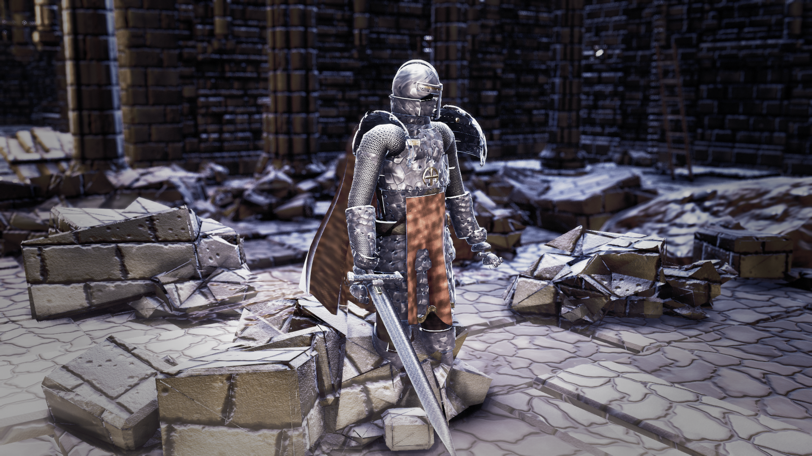
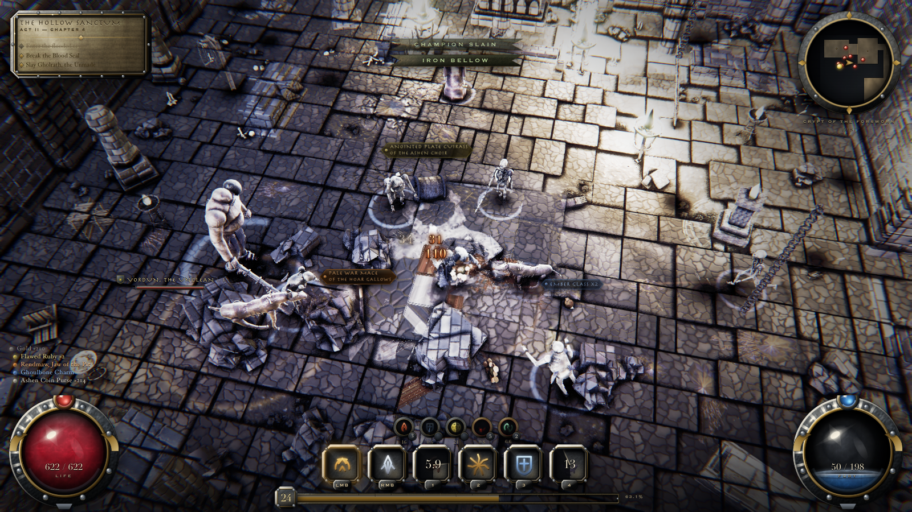
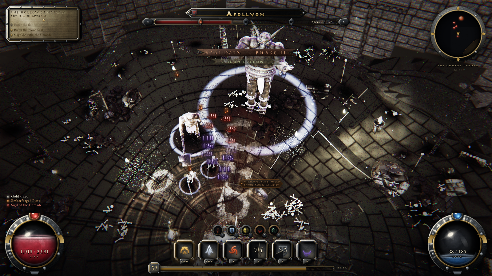
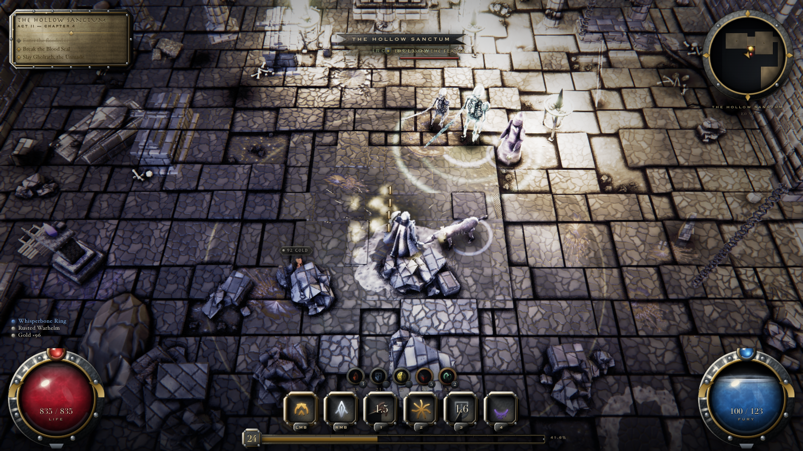
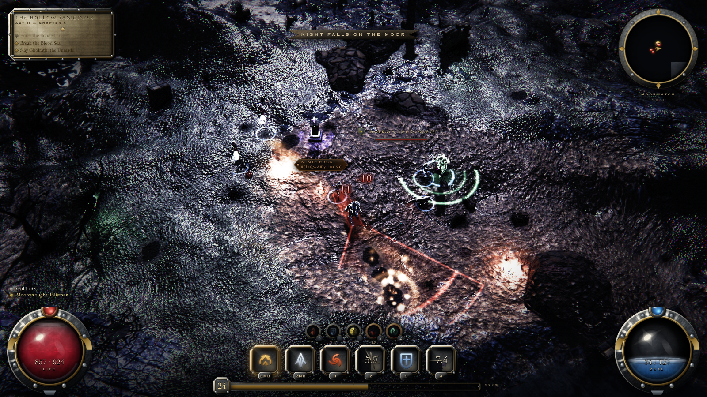
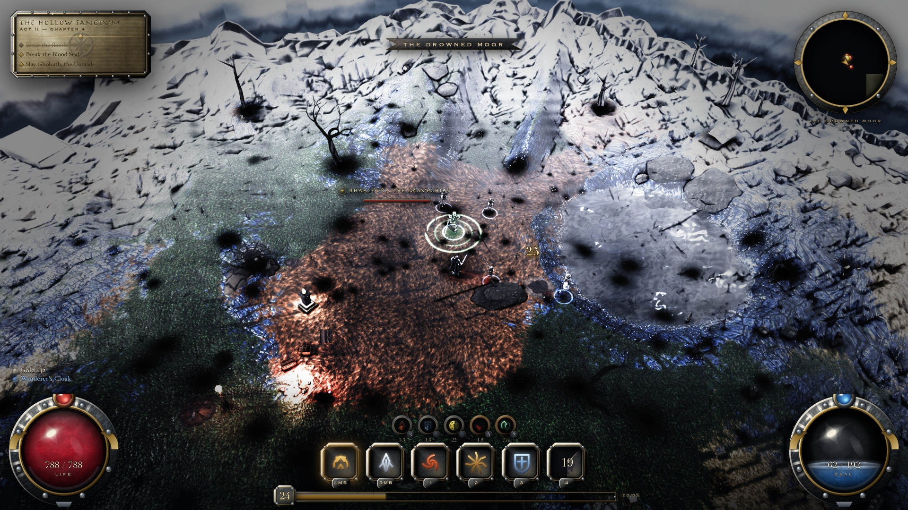
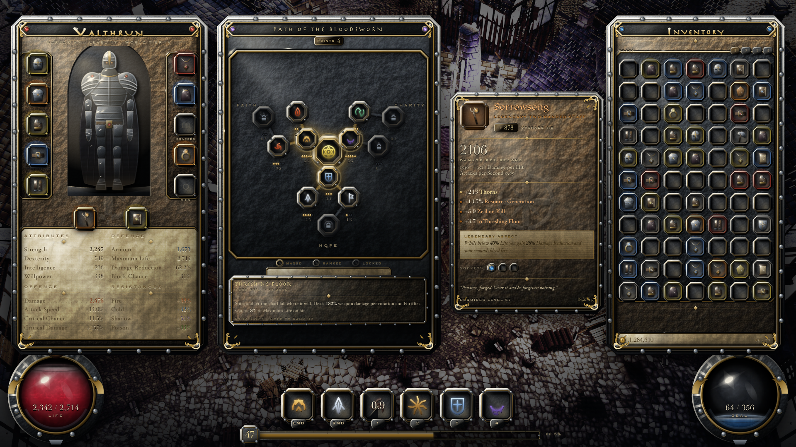

# THE NINTH VIGIL

[](https://github.com/iamlukethedev/The-Ninth-Vigil/actions/workflows/ci.yml)
[](LICENSE)

A Diablo-class isometric action RPG that runs in a browser tab, built on Three.js — in which
**every texture, mesh, skeleton, animation, sound and note of music is generated procedurally at
runtime.** There are no image files, no models, no fonts, no audio files, and no network fetches.
The repository contains no binary art assets at all, because there are none to contain.

**And every line of it was written by AI agents.** As far as we know this is the first game built
end to end by [Hermes](https://github.com/NousResearch/hermes-agent) agents — not autocompleted
with AI assistance, but architected, implemented, reviewed and debugged by agents working against a
written contract, with a human directing rather than typing. That is the actual experiment here, and
**it is an open invitation: bring your own agents and let's build this game together.** See
[Built by agents](#built-by-agents).



Roughly 107,000 lines across 142 ES modules, 22 engine systems, WebGL2 via Three.js r185. No
engine, no editor, no asset pipeline.

---

## Table of contents

- [Built by agents](#built-by-agents)
- [The premise](#the-premise)
- [The constraint that defines the project](#the-constraint-that-defines-the-project)
- [Quick start](#quick-start)
- [Screenshots](#screenshots)
- [What is actually in it](#what-is-actually-in-it)
- [Architecture](#architecture)
- [Determinism, and why it matters here](#determinism-and-why-it-matters-here)
- [The verification loop](#the-verification-loop)
- [Design rules](#design-rules)
- [Honest assessment](#honest-assessment)
- [Repository layout](#repository-layout)
- [Contributing](#contributing)
- [License](#license)

---

## Built by agents

This repository is a working answer to a question that usually gets argued about rather than tested:
**can AI agents build and maintain something genuinely hard?** Not a to-do app or a landing page —
a real-time renderer with cascaded shadows, a procedural character rig, a navigation mesh with pack
coordination, and a 16-sampler GPU budget that punishes carelessness by turning the screen white.

The build was run with [Hermes Agent](https://github.com/NousResearch/hermes-agent), the
open-source self-improving agent from [Nous Research](https://nousresearch.com). Hermes is
MIT-licensed, runs on your own infrastructure rather than inside an editor, keeps memory across
sessions, and spawns subagents for parallel workstreams — which is what made a project this size
tractable. Waves of subagents took separate modules against a shared written contract, and the
skills system meant a lesson learned once did not have to be re-explained.

Three things turned out to matter far more than model choice, and they are why this repo is
structured the way it is:

**A written contract beats instructions in a chat.** `ENGINE_CONTRACT.md` defines the module
lifecycle, the services, the event bus, the determinism rules and the performance budget. Every
agent reads it before writing code. Most integration failures traced back to something the contract
did not say.

**An objective function beats self-assessment.** Agents are persuasive about their own work, which
makes "I fixed it" worthless on its own. So correctness here is *measured*: deterministic
screenshots, `CRITIC_RUBRIC.md`'s fifteen instant-fail flags, and `tools/guard.mjs` and
`tools/smoke.mjs` in CI. The most repeated failure on this project was an agent changing code,
reasoning that it should work, and reporting success while the defect sat untouched at the same
pixel coordinates. Pixels do not negotiate.

**Parallelism needs partitioned file ownership.** When six subagents once ran at once, two both
owned `Decals.js` and two both owned `Lighting.js`. Last write won, and the rest silently vanished.

### The invitation

**This is a collaborative experiment, and you are invited — bring your agents.**

Point Hermes, or whatever agent you run, at this repository and have it pick up work. Everything an
agent needs to be productive without asking questions is already committed: the contract, the
rubric it will be judged against, `KNOWN_ISSUES.md` with pixel coordinates and measured
before-and-after numbers, and tooling that makes claims checkable rather than asserted. Point your
agent at `CONTRIBUTING.md` first — it is written to be read by one.

Good first targets are in [Honest assessment](#honest-assessment) and `KNOWN_ISSUES.md`: the
overworld has no highlights, additive sprites clip to white discs, enemy materials read as
near-white at gameplay distance, and there is an open bug where black triangular flashes appear
only while the player walks — invisible to every static capture, which makes it a genuinely
interesting agent problem.

Two ground rules, and they apply to humans and agents identically. **Prove visual changes in
pixels**, with before-and-after crops of the same region and the measured numbers. And **say in
your PR that an agent wrote it, and which one** — not as a disclaimer, but because comparing how
different agents perform against the same contract and the same rubric is part of the point. If
your agent gets stuck somewhere the documentation should have carried it, that is a bug in the
documentation; open an issue about it.

---

## The premise

Diablo's title is the villain's name. Its difficulty ladder names the destination: Hell, Inferno,
Torment, Abyssal. Its thesis is *eternal* conflict — the world never heals, and it is always about
to fall again, forever, which is why there is always another sequel.

The Ninth Vigil is that structure inverted, and the inversion is stated in data rather than in
cutscenes.

The ninth hour is three in the afternoon, the hour of the crucifixion — the moment when, from
inside the story, evil has plainly and completely won. A vigil is a watch kept through the night;
you cannot keep one at noon, and it only ends one way, at daybreak. **The word contains its own
sunrise.** So the title means *the watch kept at the hour of total defeat*, and the game is about
a hero who keeps fighting when it looks lost and turns out to be right.

Concretely, that produces a game where:

- **The difficulty ladder climbs toward dawn.** The tiers are the canonical hours of the night
  office — Vespers, Compline, Nocturn, Matins, **Lauds** — so the hardest tier is named for
  sunrise rather than for damnation, and the tier colours walk the same arc from dusk blue to dawn
  gold. See `DIFFICULTY` in `src/game/director/WorldState.js`.
- **The campaign is nine vigils**, ending on a level called The Ninth Vigil. The title drop is the
  last room.
- **No system is named for a vice.** The hero's resource is **Zeal**, not Fury or Rage. The skill
  tree's three branches are **Faith, Hope and Charity**, and the charity branch gives where a
  blood branch would drain.
- **The outcome is never in doubt — only its cost is.** The intended design of death is that it
  takes time and resources from you but never ground: light already gained stays gained.

The references throughout the world, item and ability text are deliberately submerged. Nothing
preaches, and every string reads as ordinary gothic flavour if you do not know the source. That is
the point, and it is a design rule rather than a stylistic preference — see
[Design rules](#design-rules).

## The constraint that defines the project

**No external assets, ever.** Not as a stunt, but because it forces every visual problem to be
solved as a *generator* rather than as a purchase.

- 13 procedural PBR material families (stone, cobble, wood, metal, gold, cloth, leather, flesh,
  bone, dirt, moss, ash, blood) with coupled wear — grime makes a surface darker, rougher and more
  occluded together, because that is what dirt does.
- Normals are Sobel-derived from generated height, packed into ORM, fed through PMREM for
  environment lighting.
- The hero is a procedurally rigged and skinned 93k-triangle mesh — helm, layered plate, mail,
  tabard, a Verlet-simulated cloak and a sword — with foot-planting IK. Nobody modelled it.
- The gothic crypt is generated architecture: coursed ashlar, ribbed vaults, pointed arches with
  real voussoirs, fluted columns, then an age-and-damage pass over the result.
- Audio is synthesised — SFX from oscillator/noise graphs, and an adaptive modal score.
- There are no font files. Display type is composed from the OS inscriptional-serif stack and then
  *gilded as metal* — a dark cut sunk under every stroke, worn leaf, tarnish, a raking crest — in
  a canvas, because a coloured `text-shadow` cannot produce specular, and specular is the whole
  difference between a boss name and a caption.

The full dependency list is three, vite and playwright. Adding a runtime dependency is out of
bounds.

## Quick start

Requires Node 20+ and a WebGL2 browser. Chromium is recommended; the capture tooling drives it.

```bash
git clone https://github.com/iamlukethedev/The-Ninth-Vigil.git
cd The-Ninth-Vigil
npm install
npm run dev          # http://localhost:5190
```

Controls: click-to-move or WASD, left and right mouse for attacks, `1`–`4` for abilities, `Space`
to dash, `Q` for the war cry. Audio needs one click on the page first, because of browser autoplay
policy.

You can boot a specific scenario and quality tier with query parameters:

```
http://localhost:5190/?shot=boss&q=med
```

Scenarios are `hub`, `overworld`, `dungeon`, `combat`, `boss`, `night`, `closeup`, `inventory`.

Expect one warning in the console on boot:

```
[assets] texture budget reached (150MB) — new maps degrade to 512px
```

That is `AssetForge` working as designed under its soft VRAM ceiling, not a bug — but it does mean
the project runs at its texture budget, so any new generated map costs resolution somewhere else.

## Screenshots

All eight are deterministic captures produced by `npm run check`, not hand-picked moments.

| | |
|---|---|
|  |  |
| Mid-fight in the crypt | The Apollyon arena |
|  |  |
| Crypt interior, volumetric shafts | Night exterior, rain, emissive sources |
|  |  |
| The moor under storm light | Character sheet and skill tree |

## What is actually in it

**Rendering.** GTAO, SSR, physical bloom, volumetric light shafts, depth of field, motion blur,
ACES filmic tonemapping, a 3D-LUT colour grade with per-scenario looks, film grain, chromatic
aberration, vignette, TAA/SMAA, auto-exposure. Contact AO is split into an estimate pass and a
3x3 binomial-tent resolve, which is what killed a halftone dither artifact that a naive
single-pass approach produced.

**Lighting.** Four-cascade shadow maps, importance-selected shadow-casting practicals (torches
compete for a fixed pool of shadow slots based on screen contribution), layered deterministic
flame flicker, IBL plus a hemisphere term, and a light-probe irradiance grid. There is no flat
`AmbientLight` fill anywhere.

**World.** Eroded chunked-LOD terrain with height-blended four-layer splatting and triplanar
slopes, a `_moorRelief` landform pass that carves bedrock ribs, peat hags and groughs; procedural
gothic crypt architecture; instanced props (vegetation, rock, ruin, human, macabre) with working
light fixtures; water, blood and lava surfaces; rain, snow, embers, dust and fog banks; and a town
with buildings, walls, market stalls and NPCs.

**Actors.** The procedural hero rig, six enemy archetypes and a boss, all with generated skeletons,
skinning and animation clips, plus ragdoll physics on death.

**Gameplay.** Ten abilities, hit-stop, knockback, stagger, damage types with resistances and crits,
A* navigation with local avoidance and attack-token pack coordination (so nine enemies do not all
swing at once), multi-phase boss fights, full itemization with procedurally named and flavoured
legendaries, and an encounter director that paces waves against a tension model.

**UI.** An ornate gothic HUD: liquid health and zeal orbs, a rune ability bar with cooldown sweeps,
XP bar, framed minimap, quest log, boss phase bar, floating damage numbers, rarity-coloured loot
labels, a paper-doll character sheet, a skill tree and item tooltips. All of it drawn procedurally.

## Architecture

The engine is a service locator plus a fixed-order module list. Every module is a class with the
same shape:

```js
export class MyModule {
  static id = 'myModule';
  constructor(engine) { this.engine = engine; }
  async init() {}                 // build GPU resources, add to scene
  update(dt, elapsed) {}          // per-frame sim; dt is fixed when stepping
  resize(w, h) {}
  dispose() {}
}
```

Modules are registered in `src/game/modules.js` and loaded in dependency order: assets, then
world, then actors, then combat, then physics, then camera, then VFX, then UI, and `render` last
so it composites everything produced that tick. Loading is glob-based and tolerant — a module
whose file is absent is simply skipped, which is what let the game boot at every stage of being
built.

Modules never reach into each other. The only cross-module channel is the event bus
(`engine.bus`), carrying events like `damage`, `death`, `ability:cast`, `impact`, `loot:drop`,
`level:up`, `camera:shake` and `weather:set`. A module that throws is caught by its own handler and
disables itself rather than killing the frame loop.

`ENGINE_CONTRACT.md` is the binding version of all of this, including the engine services, the
performance budget and the art-direction bible. **Read it before writing code.**

Two constraints worth knowing before you touch rendering:

- **Sixteen fragment samplers is a hard GPU limit and this project sits near it.** Exceed it and
  shaders fail to *link*, at which point WebGL draws those materials flat white and the entire
  scene turns white. This has happened twice. If you add material maps, watch the console for
  `texture image units count exceeds` and `program not valid`.
- **Engine identifiers use a `nona` prefix** — GLSL functions, `#define`s, DOM ids, material and
  texture names, program cache keys, and the `window.__NONA__` harness global. *Nona* is the Latin
  name of the ninth hour. It is deliberately not `vigil`, because `vigil` is already a lore token
  in the item tables and the prefixes would be indistinguishable.

## Determinism, and why it matters here

Determinism is mandatory, and it is not for netcode — it is what makes the visual review possible.

- No `Math.random()` anywhere. Use `engine.rand(seed)`.
- No `Date.now()` or `performance.now()` in simulation code. Use `engine.clock.elapsed`.
- The same scenario stepped the same number of frames must produce a **byte-identical** PNG.

That last property is the whole point. If frames drift between runs, you cannot attribute a pixel
change to a code change, and every visual fix becomes unfalsifiable. Because captures are stable,
you can `md5` two of them and know for certain whether your change did anything.

## The verification loop

This is the most unusual part of the project and the reason it looks the way it does. The game is
judged by capturing frames and measuring them, not by reasoning about the code.

| tool | purpose |
|---|---|
| `node tools/guard.mjs` | enforces the hard rules — no `Math.random()`, no runtime fetches, no external asset references, no stubs, no dependencies off the allowlist. Seconds, no browser. CI gates on it |
| `node tools/smoke.mjs` | asserts the game boots, every module loads, every shader program **links**, and two independent runs of a scenario reach identical simulation state. `--pixels` adds a canvas hash. CI gates on it |
| `node tools/shot.mjs --all --w=1600 --h=900` | deterministic headless capture of all 8 scenarios |
| `node tools/sheet.mjs --analyze` | contact sheet plus objective frame metrics — lifted blacks, missing highlights, contrast collapse, oversaturation |
| `node tools/crop.mjs --in=shots/combat.png --x=0.5 --y=0.5 --w=0.25 --scale=4` | crop and nearest-neighbour zoom. Essential: a 1600x900 frame viewed whole hides the defects that matter |
| `node tools/actors.mjs --port=5190` | actor visibility audit — is a character not drawing, off-frame, too small, or indistinguishable from the floor |
| `node tools/live.mjs --port=5190` | capture the live browser path, which catches bugs the harness cannot see |
| `node tools/debug.mjs --scenario=combat` | boot with full console and error output |
| `node tools/probe.mjs --port=5190` | live scene-graph inspection |

`npm run check` runs the capture and the analysis together; `npm run guard` and `npm run smoke` are
the two that CI enforces on every push and pull request.

CI runs on GitHub-hosted runners, which have no GPU, so the smoke job renders through SwiftShader.
Two consequences worth knowing if you touch it. Chromium's compositor **hangs indefinitely** when
asked to screenshot a canvas under software rendering — the frame renders fine, the capture never
returns — so the smoke test hashes simulation state (actor positions, health, clock) instead of
pixels. That turns out to be the stronger check anyway: sim state is what `Math.random()` or a
wall-clock read actually corrupts, whereas a same-machine pixel hash mostly re-tests the GPU. And
the assertion is that the two runs agree with *each other*, never against a stored hash, because
software and hardware output legitimately differ and asserting cross-machine equality would produce
a permanently red build.

The CI scenario is `combat`, which puts nine actors under live AI so the determinism check has
something to bite on — and it holds more strongly than the contract requires. Forty-five frames of
pathfinding, avoidance and attack-token arbitration hash to `761af13895c0` on local hardware GL, on
local SwiftShader, and on a GPU-less GitHub runner: **simulation state is identical across machines
and across rendering backends**, not merely stable run to run. That also confirms the
`performance.now()` work-splitting budgets in `AI.js` and `NavGrid.js` never leak into simulation
results, which is the one thing that could have made those budgets unsafe.

That property would allow a stored golden hash as a regression gate. It is deliberately not used:
any legitimate balance change moves the hash, so the gate would mostly generate "just update the
expected value" commits, which trains people to bypass exactly the check it exists to enforce.
Comparing two runs against each other needs no maintenance and catches the real failure mode.

`CRITIC_RUBRIC.md` defines ten scored axes and fifteen **instant-fail flags** — things like a
black or single-colour frame, untextured flat-colour geometry, obvious texture tiling, or uniform
full-frame bloom haze. Any one of them fails the frame outright regardless of the other scores.

Three lessons from this project are worth stating plainly, because each cost real time:

**The harness and the live game are structurally different worlds.** `shot.mjs` loads `?shot=X`,
so `Terrain.init()` reads the query parameter and boots straight into the correct biome. The live
game has no parameter, boots to the moor, and only rebuilds to the right biome later. Any bug that
depends on that ordering is invisible to every screenshot the harness takes. This actually
happened: a player reported "I can't see my hero or any enemies" while every canonical capture
showed them rendering perfectly, because the crypt geometry stayed baked on the moor heightfield
while actors were placed on the new one — so every character stood 3.5 m *below the drawn floor*.
**For anything a player can see, verify on the live path.**

**Prove every fix in pixels, not in code.** The dominant failure mode here is changing code,
reasoning that it should work, and reporting success while the defect is untouched. Capture the
scenario, zoom the exact region, look at it, make the change, re-capture the identical crop, look
again. State measured values.

**Serialize by file ownership.** When six fixers once ran in parallel, two both owned `Decals.js`
and two both owned `Lighting.js`. Whoever wrote last won, and a reviewer then correctly found
seven of thirteen defects still present at the same pixel coordinates.

## Design rules

Beyond the engine contract, the fiction has rules. They exist so the premise survives contact with
contributors.

1. **The ladder points at light.** Anything that ranks or escalates — difficulty, depth, chapter,
   tier — is named for a movement toward dawn, never toward damnation. A "Torment" tier is a
   rejected patch.
2. **No system carries a vice's name.** Resources, skill branches and stats take virtues. This is
   why Fury became Zeal.
3. **Good wins; the cost is the drama.** Do not add mechanics whose tension comes from the
   possibility of total loss. Tell the player the ending early and make them pay for it.
4. **References stay submerged.** Every string must read as plain gothic flavour to someone who
   does not recognise the source. The moment a line explains itself, it stops working — so no
   chapter-and-verse citations in player-facing text, no glossary, no lore entry decoding the
   title.
5. **The place is the Sanctum; the order is the Vigil.** The project was called SANCTUM until July
   2026. Six in-world uses of the word survive on purpose and are not stale references.

`HANDOFF.md` documents the naming migration and the reasoning behind each of these in detail.

## Honest assessment

This section exists because the alternative is letting the screenshots oversell it.

A hostile art-director review scored the build **3.5/10, NOT_AAA** over two rounds. Every
per-scenario blind A/B against a comparable Diablo 4 capture preferred Diablo 4, most recently
"not close." The frames pass the objective analyser; the images are the real judge.

The remaining gap splits into two kinds, and only one is fixable by iteration:

*Fixable engineering* — clipped additive sprites, missing contact occlusion in bright areas, an
overworld with no highlights, enemy materials that read as near-white at gameplay distance, flat
rubble. Real bugs, all tracked in `KNOWN_ISSUES.md`, which is the authoritative open list.

*Art production* — in the reviewer's own words, "D4 never lets you see a repeat or a straight
continuous joint; its floors break, sag, lift, and pool water in depressions." That is hundreds of
artists hand-placing individual assets over years, not a shader problem. Any generator produces
*some* detectable regularity, and a reviewer told to find flaws will find it. The same goes for
Diablo 4's roughly 200 hand-sculpted armour sets against one procedural rig.

**The working definition of done is driving the instant-fail count to zero.** That is the line
between "looks broken" and "looks like a genuinely good atmospheric ARPG running in a browser."
Chasing 8+ on every rubric axis past that point mostly re-litigates procedural-versus-authored.

Performance, measured at 1600x900 on Apple Silicon: average frame time lands between 7.9 and
11.3 ms for seven of the eight scenarios, inside the 16.6 ms budget. The `inventory` scenario, which
draws the full UI over the town, is over budget at roughly 21 ms average. Draw calls and triangle
counts are also over their targets — around 1,000 to 1,400 calls against a 900 budget — mostly in
shadow passes.

Two known bugs are open and worth flagging for anyone building on this:

- **Black and white triangular flashes while the player walks.** Transient hard-edged polygons that
  appear only during locomotion, so every static capture misses them. The current leading
  hypothesis is `LightPool` slot reuse in `src/render/Lighting.js` rendering one frame with a stale
  shadow camera. Reproducing it needs Playwright driving the hero and diffing consecutive frames.
- **A damage-governor workaround in `Director._handOverToPlayer()`** that reaches into
  `CombatSystem` internals. The durable fix is one line in `CombatSystem._readInput()`: latch the
  governor release on `input.userActed` rather than on a keypress, which also closes a hole where
  keyboard-only play never released it at all.

## Repository layout

```
src/
  core/       Engine, module loader, deterministic PRNG/noise, AssetForge, texgen, culling
  render/     RenderPipeline and post passes, Lighting, LightRig, Sky, Atmosphere, Weather
  world/      Terrain, TerrainMaterial, Dungeon, Props, Town, Water, and their sub-kits
  chars/      Hero, Bestiary, procedural skeletons, skinning, anim graph, cloak, monsters
  combat/     CombatSystem, Abilities, Damage, HitFeel, and a small rigid-body/ragdoll physics kit
  game/       Director, WorldState, encounters, objectives, AI, loot, items, affixes, CameraRig
  vfx/        VFXSystem, emitters, decals, trails
  audio/      AudioEngine, procedural SFX kit, adaptive modal music, ambience
  ui/         HUD and panels, procedural UI atlas and theme
tools/        Headless capture, frame analysis, cropping, actor audit, live probe, debug boot
shots/        The eight canonical deterministic captures
```

Four documents carry the project's institutional memory, and they are worth reading in this order:

1. **`ENGINE_CONTRACT.md`** — the binding integration contract. Module lifecycle, engine services,
   the event bus, determinism rules, performance budget, art-direction bible, and which bundled
   `three/addons/*` to use instead of hand-rolling.
2. **`CRITIC_RUBRIC.md`** — the ten scored axes, the fifteen instant-fail flags, and the required
   verdict format. This is how work is judged.
3. **`KNOWN_ISSUES.md`** — every confirmed defect with pixel coordinates and measured before/after
   numbers, plus the canonical world-scale table (1 unit = 1 metre). Getting scale wrong has been
   the single most repeated failure on this project.
4. **`HANDOFF.md`** — the long-form continuation brief, including the naming migration.

## Contributing

Issues and pull requests are welcome, **from humans and from agents equally** — see
[the invitation](#the-invitation). **[CONTRIBUTING.md](CONTRIBUTING.md)** is the full guide, written
to be handed straight to an agent; the short version is:

- Read `ENGINE_CONTRACT.md`. It is short, and it is the difference between a patch that lands and
  a patch that breaks a shader link.
- **No new dependencies, and no external assets.** If your fix needs a texture, generate it in
  `src/core/texgen/`.
- **Prove visual changes in pixels.** Include a before and after crop of the same region at the
  same scale, and state the measured numbers (luma, pixel size, draw calls — whatever the change
  claims to move). `node tools/crop.mjs` produces them.
- **Verify on the live path**, not only in the harness. The harness cannot see an entire class of
  bug, and this has cost real time.
- Keep determinism: no `Math.random()`, no wall-clock time in simulation code. Two captures of the
  same scenario must still `md5` identically.
- Respect the [design rules](#design-rules).
- Do not edit `src/main.js`, `src/core/Engine.js`, `src/game/modules.js`, `src/game/Scenarios.js`,
  `index.html` or `tools/*` without a deliberate reason. They are the integration spine every
  module is written against.

Run `npm run guard && npm run smoke` before pushing — those are what CI checks.

One note on house style, since it will strike you immediately: the comments are unusually dense,
and most of them record a measurement, an approach that was tried and rejected, or why an
apparently redundant line is load bearing. That is deliberate. On a project whose defects are
visual and whose fixes are easy to get wrong twice, the reasoning behind a line is worth more than
a restatement of what it does. Please write them the same way.

## License

MIT. See [LICENSE](LICENSE).

Three.js is BSD-3-Clause and is not vendored here; `npm install` fetches it.
